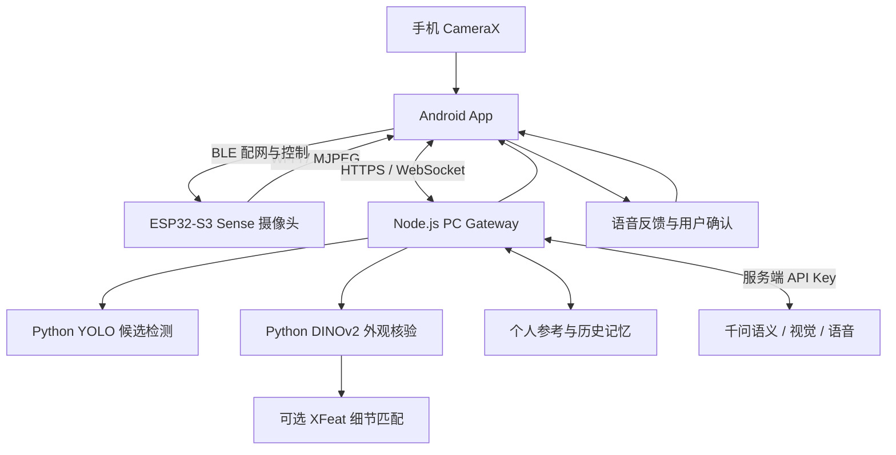

# I SEE YOU

**面向视障用户的个性化长记忆找物助手。**

从“画面里有什么”进一步探索“是不是用户之前记住的那一件”。结合自然语言、手机或 ESP32 摄像头、个人参考记忆和视觉外观核验，组织物品记录、历史回忆、寻找与用户确认。

项目进入天猫 AI 黑客松「科技无碍」赛道全国决赛 24 强。本仓库整理自 2026-11-07 赛事提交快照，包含实际工程源码与测试，不是已通过长期用户验收的商业产品。

## 核心能力

- 保存个人物品的参考照片、外观描述、位置和观察记录，跨会话调用。
- YOLO 提出候选，DINOv2 结合颜色、比例及可选 XFeat 细节核验个人参考；类别检测不等于个人身份确认。
- 通过语音进行记录、寻找、核对、纠错及结束；候选歧义由语音澄清。
- Android CameraX / ESP32 MJPEG 视频源切换、BLE 配网、设备控制、局域网发现与 TLS 配对。
- 帧时效、任务版本和取消控制避免过期结果；找到不等于拿到，历史位置不能冒充当前观察。

## 系统架构



当前个人外观模型运行在 **电脑 Gateway 的 NVIDIA CUDA GPU** 上；ESP32 主要负责采集和连接，不在板端执行 DINOv2。历史手机 TFLite 和 Web/云端实现保留在代码中，不应混为同一部署。

[架构与数据流](docs/ARCHITECTURE.md) · [硬件说明](docs/HARDWARE.md) · [依赖与模型](docs/DEPENDENCIES.md) · [发布检查](docs/VALIDATION.md)

## 工程目录

| 路径 | 作用 |
| --- | --- |
| `android/` | Kotlin/Java 原生 App、CameraX、语音、设备连接及原生测试 |
| `esp32-firmware/` | 摄像头固件、BLE 配网和不同硬件交互版本 |
| `pc-gateway/src/` | 会话、意图路由、任务编排、记忆、配对与服务接口 |
| `pc-gateway/python/` | 视觉推理、图像处理、参考特征与存储辅助 |
| `pc-gateway/vendor/` | 第三方视觉组件，保留上游许可证 |
| `pc-gateway/test/` | 找物、确认、取消、纠错、记忆及接口测试 |
| `web/`, `src/`, `cloudflare/`, `netlify/`, `supabase/` | 历史 Web 和可选云服务工程 |
| `demo/`, `tests/`, `scripts/` | 演示、测试、构建与本地资产恢复工具 |

## 快速开始

### 先运行不依赖硬件和模型的逻辑测试

需要 Node.js 24 或以上：

```sh
git clone https://github.com/xswdd666/I-SEE-YOU.git
cd I-SEE-YOU/pc-gateway
npm ci --ignore-scripts
node --test --test-concurrency=1 test/stop-after-match.test.mjs test/four-stage-boundaries.test.mjs test/memory-dialogue.test.mjs test/found-location.test.mjs test/object-naming.test.mjs test/task-boundaries.test.mjs test/spatial-order.test.mjs test/speech-preparation.test.mjs
```

逻辑检查使用测试夹具/替身，不代表真实摄像头、模型效果或用户体验已通过。`npm test` 含真实模型测试，未恢复资产和 GPU 环境时不应视为可直接全量通过。

### 恢复模型与 SDK

Git 不打包模型权重、第三方 Android SDK、APK、用户照片、聊天历史、密钥、配对凭据和依赖环境。已有合法取得的完整交接包时，在仓库根目录执行：

```powershell
.\scripts\restore-local-assets.ps1 -SourceDirectory 'D:\your-private-handoff'
```

参数应指向包含 `android/`、`pc-gateway/`、`models/` 的交接根目录，不是 ZIP。工具只恢复指定模型/SDK 目录，不复制配置和运行数据。没有交接包时，参见 [依赖说明](docs/DEPENDENCIES.md)；原手机 TFLite 的训练与许可来源不完整，不提供未经验证的替代下载。

### 启动电脑 Gateway

Windows、64 位 Python 3.11、Node.js 24、兼容 CUDA 12.6 的 NVIDIA 驱动和已恢复的模型。显存与端到端性能需在目标电脑实测。

```powershell
cd pc-gateway
.\准备电脑环境.ps1
# 在本地生成的 .env 中填写自己的 DASHSCOPE_API_KEY
.\启动电脑服务.ps1
```

准备脚本安装依赖并执行 GPU 自检，随后生成 `.env`。手机和电脑处于同一局域网，通过 App 重新配对。服务默认 TCP 8765，发现 UDP 8766；首次运行生成本机 TLS 证书、配对凭据及空记忆库。运行数据位于 `pc-gateway/runtime/`，不进入 Git。

### 构建 Android

先恢复模型和 `android/app/libs` 所需 SDK。安装 JDK 21、Android SDK 36，配置 `ANDROID_HOME` 或本机 `android/local.properties`。Java/Kotlin 字节码目标是 17，与运行 Gradle 的 JDK 版本不是同一个概念。

```powershell
node scripts/build-android-assets.mjs
cd android
.\gradlew.bat -PisolatedTabletTest=true -I scripts/voice-debug.gradle :app:assembleDebug
```

构建脚本按 manifest 重建并校验原 TFLite；目标 ARM64、最低 Android 8。云备份可选；源码保留历史部署域名，实际使用须配置自己的服务和相应域名校验，不应依赖作者测试端点。

### ESP32

使用 XIAO ESP32S3 Sense 与 Arduino ESP32 工具链；控灯版、基础版和唤醒词探索版分别位于 `esp32-firmware/`，按对应分区及 Flash/PSRAM 配置编译。详见 [硬件说明](docs/HARDWARE.md)。

## 验证与性能口径

本次整理的检查见 [发布检查](docs/VALIDATION.md)。原包 [验证结果.md](验证结果.md) 的 GPU 自检、301 项 Gateway 回归和 127 项 Android 单测属于 2026-11-07 的历史记录，不是本次重新执行结果。

早期受控 CPU 实验记录中，参考缓存使本地单候选比对 P50 从 232.86ms 降至 115.15ms（降低 50.5%）。它不代表完整语音响应、网络耗时、最终 GPU 版本性能或用户找回率；本仓库未附完整原始性能实验包，不将其作为可直接复现的基准承诺。

## 隐私、安全与限制

- 区分当前观察、明确记录、历史回忆和个人物品核验；不确定时澄清或重新观察。
- API Key 仅保存在自己的服务端；用户数据、凭据和私钥不进入源码仓库。
- 不编造距离、实时位置、行走或伸手路线。不是安全导航或医疗设备。
- 真实复杂光照、遮挡、相似物品和跨日找回效果仍需进一步评估。

## 第三方与许可

YOLO、DINOv2、XFeat、TensorFlow、Vosk 和语音 SDK 分别遵循各自许可。保留随代码提供的上游 LICENSE/NOTICE；本次不擅自给混合工程指定 MIT 等统一许可，公开可见不等于所有组件均可无限制商业再分发。
